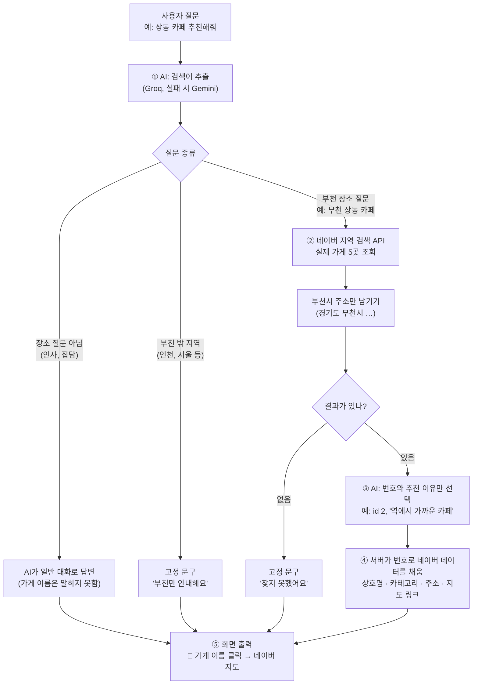

# 부천이 - 부천 맛집·나들이 안내 챗봇 (웹)

Groq API로 동작하는 웹 챗봇입니다. 부천의 맛집, 카페, 나들이 장소, 교통을 추천해 주고,
추천된 가게 이름을 누르면 **네이버 지도 검색 결과**로 이동합니다.
Groq 무료 한도가 소진되면 Gemini API로 자동 전환됩니다.

## 사용법

1. 라이브러리 설치

   ```
   python -m pip install -r requirements.txt
   ```

2. `.env.example`을 복사해 `.env`를 만들고 키를 입력합니다.

   ```
   GROQ_API_KEY=발급받은_groq_키
   GEMINI_API_KEY=발급받은_gemini_키   # 선택, Groq 한도 소진 시 사용
   NAVER_CLIENT_ID=발급받은_네이버_id
   NAVER_CLIENT_SECRET=발급받은_네이버_secret
   ```

   - Groq 키: https://console.groq.com/keys
   - Gemini 키: https://aistudio.google.com/apikey
   - 네이버 키: https://developers.naver.com → Application → 애플리케이션 등록 (사용 API: 검색)

3. 실행

   ```
   python app.py
   ```

4. 브라우저에서 http://127.0.0.1:5000 접속 후 질문을 입력합니다.

## 구조

- `app.py` : Flask 서버. `/chat`에서 Groq(실패 시 Gemini)를 호출합니다.
- `templates/index.html` : 채팅 화면. 답변의 `[[가게이름]]`을 네이버 지도 링크로 바꿔 보여줍니다.

## 동작 방식

AI가 가게 이름을 직접 쓰면 없는 가게를 지어내기 때문에, **AI는 번호만 고르고 가게 정보는 네이버 데이터로 채우는** 구조로 만들었습니다.



| 단계 | 하는 일 | 누가 |
|---|---|---|
| ① 검색어 추출 | 질문을 `부천 상동 카페` 같은 검색어로 바꾸고, 장소 질문인지·부천 안인지 분류 | AI |
| ② 가게 조회 | 네이버 지역 검색 API로 실제 등록된 가게 조회, 부천시 주소만 남김 | 서버 |
| ③ 가게 고르기 | 목록 번호와 추천 이유 한 줄만 JSON으로 선택 (이름은 쓰지 못함) | AI |
| ④ 정보 채우기 | 번호로 가게를 찾아 상호명·주소·지도 링크를 네이버 데이터로 작성 | 서버 |

그래서 목록에 없는 가게는 추천될 수 없습니다. AI가 JSON 형식을 어기면 네이버 조회 결과를 그대로 보여줍니다.
네이버 키가 없으면 ②~④를 건너뛰고 AI가 상호명을 직접 쓰기 때문에, 없는 가게를 지어낼 수 있습니다.

## 참고

- 지도 링크는 `상호명 + 시/구`로 네이버 지도를 검색하는 주소입니다. 영업시간·가격은 지도에서 확인하세요.
- `.env`는 `.gitignore`에 포함돼 있어 깃허브에 올라가지 않습니다. 키를 절대 커밋하지 마세요.
- 모델은 `.env`의 `GROQ_MODEL`, `GEMINI_MODEL`로 바꿀 수 있습니다. (기본: `openai/gpt-oss-20b`, `gemini-3.5-flash-lite`)
